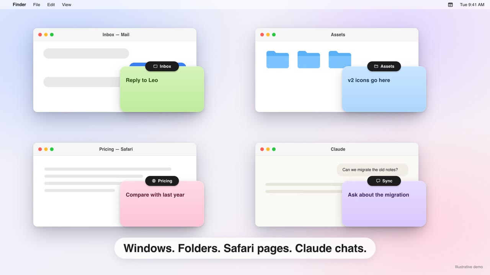

# Hintlet

A macOS menu-bar app that sticks notes onto the work you're doing, such as a window, a folder, a web page or a Claude conversation. It hides them when you switch away and brings them back when you return.

[](promo/v7/Hintlet-v7.mp4)

*Watch the [44-second demo](promo/v7/Hintlet-v7.mp4) (with sound). It's an animated illustration of the app, not a screen recording.*

> **Preview release.** Everything described here is built and covered by automated tests, but many hands-on checks haven't been done on a real Mac yet, and some scopes are marked *experimental*. See [Known limitations](#known-limitations).

The app is in English and Traditional Chinese. Project docs (spec, ADRs, spike reports) are in Traditional Chinese; the glossary is [CONTEXT.md](CONTEXT.md).

## Features

- **⌘⌥N** adds a note at the pointer, ready to type. Drag anywhere on a note to move it; click to edit, with the caret where you clicked. Checklists, undo/redo and resizing work as you'd expect. **Esc** stops editing and hands focus back to the app you were in.
- Click the label at the top of a note to collapse or expand it. Press and hold the label, or right-click it, to change the colour, delete the note or change what it sticks to.
- **What a note can stick to:**
  - **Window**, in any app. The note follows the window as it moves, resizes, minimises, goes full screen or changes display.
  - **Folder or document**, in Finder and in apps that report a file path (Pages, Preview, TextEdit…). Any window showing it brings the note back, even after a restart.
  - **Claude conversation**, in Chat, Cowork and Code in the Claude desktop app. The note shows only on that conversation and comes back after Claude or Hintlet restarts.
  - **Codex thread**, in the Codex app, as long as no other thread has the same name (see Known limitations).
  - **Web page** *(experimental)*, in Safari, matched by address. Private windows only stick to the window, and their addresses and titles are never saved.
  - **Claude Code session** *(experimental)*, in Terminal or iTerm. The note comes back when you run `claude --resume`.
  - **Floating**, shown on every desktop, including full-screen spaces.
- **Notes that lose their window.** A note on an ordinary window can't follow it when the app restarts, so All Notes keeps it as waiting to be found. When a window from the same app with the same title opens, a small marker offers to put the note back, and nothing moves until you accept.
- **Delete and undo.** You can undo a delete (or press ⌘Z) for 6 seconds, and deleted notes stay in the trash for 30 days.
- **All Notes (⌘⌥L).** Search every note, bring back notes that are waiting for their window, restore notes from the trash, or jump straight to a Claude conversation.
- **AI notes.** A note on a Claude conversation or a Codex thread can become an AI note, which updates the conversation's goal, key point and next step after each reply. You can turn it back into an ordinary note at any time. You choose who writes it:
  - the on-device model (macOS 26+ with Apple Intelligence; nothing leaves your Mac)
  - your Claude or Codex account, through their CLIs
  - your own Claude API or OpenAI API key, kept in the Keychain

  Every option except the on-device model uploads the conversation, and each asks for your consent first.
- **Menu bar.** Hide All for Now (handy for screen sharing), Getting Started…, and Settings… (⌘,), where you'll find shortcuts, note defaults, AI, backups, permissions and Open at Login.

## Install

Requires macOS 14 or later (developed on macOS 27).

### Download

1. Download `Hintlet-<version>.zip` from [Releases](../../releases) and unzip it.
2. Move `Hintlet.app` to `/Applications`.
3. The app isn't notarized (notarizing needs a paid Apple Developer membership), so macOS blocks it the first time. Nothing is wrong with it, and it's free to use: open it once, then go to **System Settings › Privacy & Security**, scroll down, click **Open Anyway** and enter your password. macOS doesn't ask again for that version. Or, in Terminal:

   ```bash
   xattr -dr com.apple.quarantine /Applications/Hintlet.app
   ```

4. A short welcome guide opens: what Hintlet does, turning on Accessibility (it opens System Settings for you), and making your first note with ⌘⌥N. **Getting Started…** in the menu bar menu shows it again.

After installing a newer version, macOS may no longer recognise it as the app you allowed, because it isn't notarized: the switch looks on but does nothing. Select Hintlet in the **Accessibility** list, remove it with **−**, then allow it again from **Settings › Permissions** or **Getting Started…**.

### Build from source

Requires Xcode 16 or later and an Apple ID signed in to Xcode (a free Personal Team is enough).

1. Open `Hintlet.xcodeproj`. Under **TARGETS › Hintlet › Signing & Capabilities**, choose your own Team. If the bundle ID `com.jyp.hintlet` is taken, change it to your own.
2. Build and install:

   ```bash
   xcodebuild -project Hintlet.xcodeproj -scheme Hintlet -configuration Release -derivedDataPath build/DerivedData -allowProvisioningUpdates build
   ditto build/DerivedData/Build/Products/Release/Hintlet.app /Applications/Hintlet.app
   open /Applications/Hintlet.app
   ```

A stable signature matters: macOS ties the Accessibility and Automation permissions to it. With ad-hoc signing ("Sign to Run Locally") you have to grant Accessibility again after every rebuild.

The app uses the Hardened Runtime and the Apple Events entitlement. It doesn't use the App Sandbox, because Accessibility and reading other apps' windows are restricted there.

## Permissions

Hintlet asks only when a feature needs it. You can refuse any of them, and notes fall back to a coarser scope. **Settings › Permissions** shows where each one stands.

| Permission | Asked when | Used for | If refused |
|---|---|---|---|
| Accessibility | The welcome guide, or the first ⌘⌥N | Reading the front window's position, title, document path and web address | Notes are always floating |
| Claude's full accessibility information (Hintlet's own consent, not a system permission) | The first ⌘⌥N in Claude | Lets Claude expose its web content, so the conversation's address can be read. Claude uses somewhat more resources | Notes on Claude stick to the window; turn it on or off any time in Settings › Permissions |
| Automation: Finder | The first ⌘⌥N on a Finder folder window | Asking Finder which folder a window shows | Notes stick to the window |
| Automation: Terminal, iTerm *(experimental)* | When the front tab is running Claude Code | Asking which tab (tty) is in front | Notes stick to the folder or window |

Hintlet doesn't need Input Monitoring or Screen Recording: the global shortcuts are registered as system hot keys. The only keys it notices are modifiers, so holding ⌥ can make notes see-through; it never sees what you type.

If a permission stops working (for example, it's on in System Settings but has no effect after a re-sign), remove Hintlet from that list and add it again, or reset it:

```bash
tccutil reset Accessibility com.jyp.hintlet
```

```bash
tccutil reset AppleEvents com.jyp.hintlet
```

## Your data

- Notes are saved automatically to `~/Library/Application Support/com.jyp.hintlet/notes.json`.
- `Backups/` in the same folder keeps the last 5 copies.
- **Settings › Backups** exports every note to one file and imports it again. Importing merges note by note, so nothing is duplicated, and exports never contain API keys.
- To uninstall, quit Hintlet and delete the app. Your notes stay in the folder above until you delete it.

## Known limitations

The full list is in the [verification report](docs/delivery/0001-mvp-verification.md#已知限制) (in Chinese). The main ones:

- **Many checks haven't been done on a real Mac yet**, notably switching between Claude conversations, and putting notes back on their windows after an app restart. The [manual checklist](docs/delivery/0001-manual-checklist.md) lists what's left.
- **Recognizing Claude conversations relies on interfaces Claude doesn't publish**: the web area's address, Chat's message markup, and Cowork and Code session files. If a Claude update breaks them, notes fall back to the window; they never land on the wrong conversation.
- **Chrome** only has the window scope, because it doesn't expose page addresses unless its full accessibility tree is turned on. Arc, Edge, Brave and Firefox only have the window scope too.
- **Codex threads** can only be told apart by their title, so a note goes on a thread only when no other thread has the same name; otherwise it stays on the window ([ADR-0003](docs/adr/0003-identify-codex-threads-by-unique-title.md)). Deleting or archiving a thread doesn't move its notes to the trash.
- Claude Code is only recognized in Terminal and iTerm, not in Ghostty, WezTerm or VS Code.
- Private-window detection has only been tested with the browsers in English.
- Deleting a Chat conversation doesn't move its notes to the trash, because Chat has no local file to watch.
- There's no notarization and no iCloud sync.

## Development

The core logic, which covers binding, persistence, layout and the rules for recognizing each app, lives in a local Swift package and is tested on its own:

```bash
cd Packages/HintletCore && swift test
```

Floating panels, real Accessibility reads, full screen and multiple displays have no automated tests; check them with the [manual checklist](docs/delivery/0001-manual-checklist.md). Design docs: [spec](docs/specs/0001-hintlet-v1.md), [ADRs](docs/adr/), [spike reports](docs/spikes/).

## License

[MIT](LICENSE)
